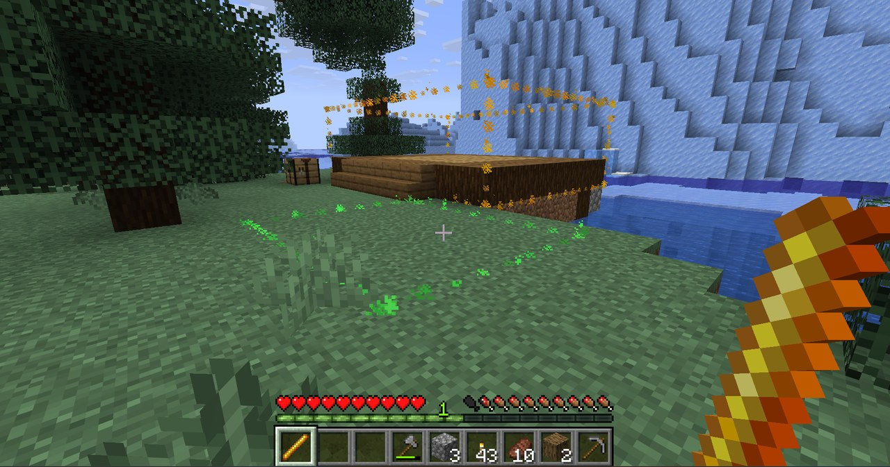
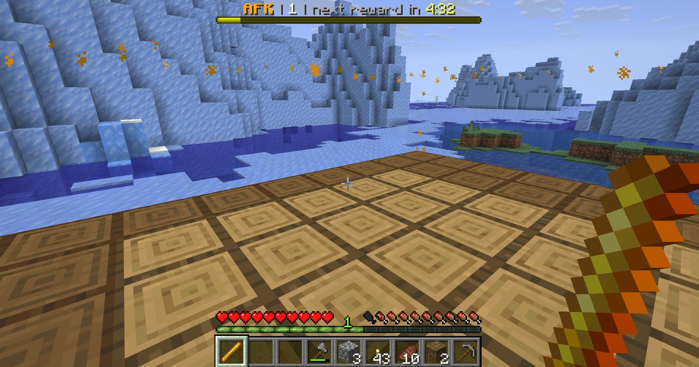
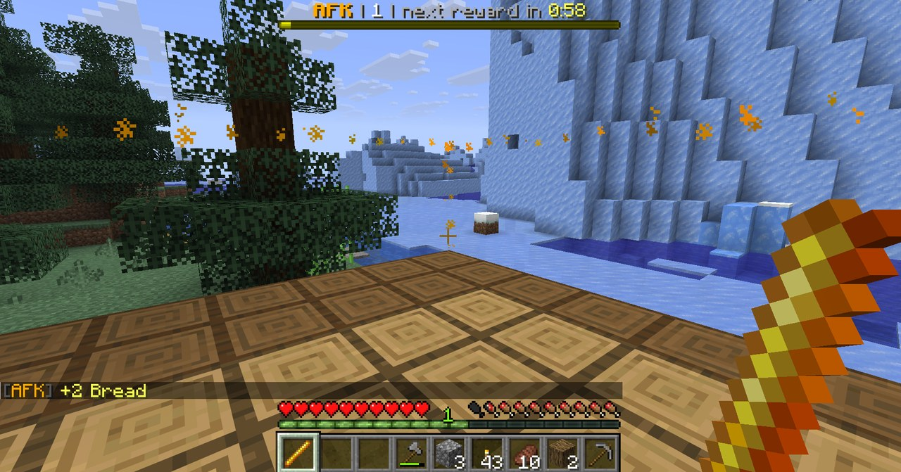
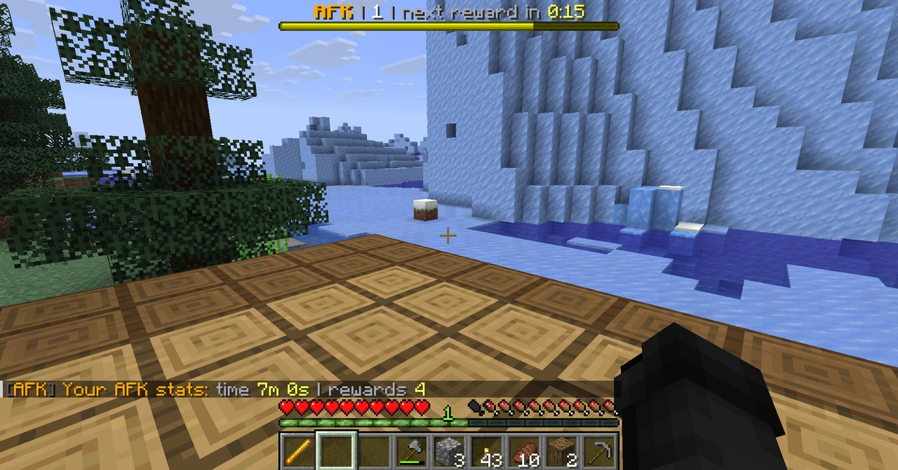
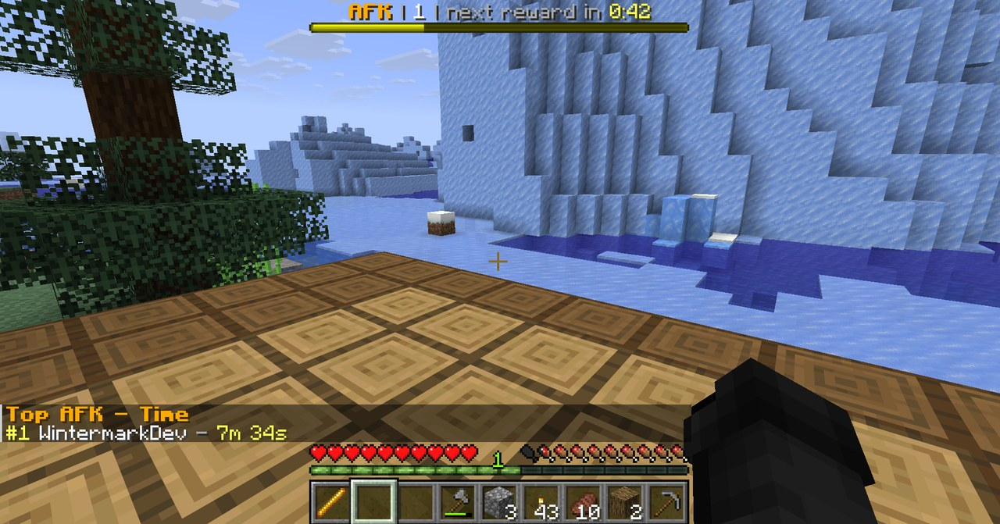
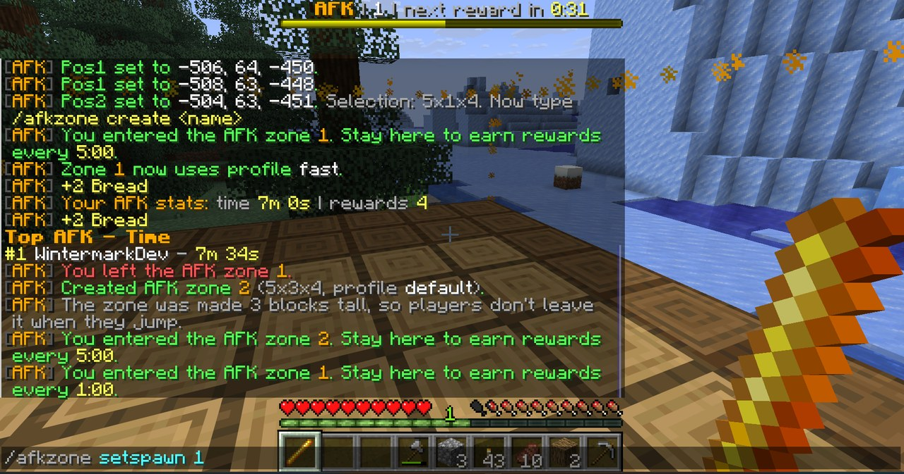
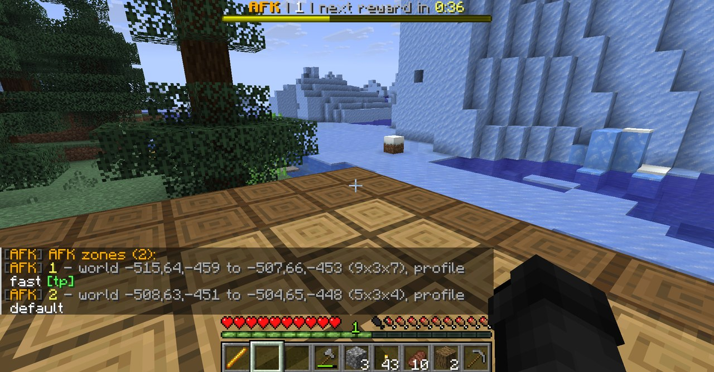

# Wintermark AFK Zones

**AFK zones for Paper servers: players stand in a zone, a bossbar counts down, and they earn rewards.**
Set up a zone in seconds with a wand, configure rewards with chances, and stop alt-account farming.



## Features

- **Zones in seconds.** Get the wand, left-click and right-click two corners, type `/afkzone create spawn`. Done. Zones show as particle outlines while you hold the wand.
- **Bossbar countdown.** Players see which zone they're in and exactly when the next reward comes. Color, style and text are configurable.
- **Reward profiles.** Items and console commands (money, crate keys, ranks...) with a chance per reward. Give every zone its own profile: a fast 1-minute zone at spawn, a 10-minute VIP zone with better loot.
- **Anti-alt.** Only one account per IP earns at a time (configurable). No more farming with five alts.
- **Stats and leaderboard.** AFK time and rewards per player, `/afkzone stats` and a top-10 by time or rewards.
- **Teleport.** `/afkzone tp` sends players straight to a zone.
- **Fully configurable.** All text with MiniMessage colors, sounds, bossbar, rewards. New settings are added to your config automatically on updates.
- **Lightweight.** No dependencies. Checks players once per second, data in small YAML files.

| Bossbar countdown | Rewards |
|---|---|
|  |  |

| Stats | Leaderboard |
|---|---|
|  |  |

| Setting up a zone | Zone list |
|---|---|
|  |  |

## Requirements

- **Paper 26.3** (or a Paper fork such as Purpur) with **Java 25**
- Not tested on Folia or Spigot

## Installation

1. Download `WintermarkAFKZones-1.0.0.jar` and put it in your server's `plugins` folder.
2. Start the server. `plugins/WintermarkAFKZones/config.yml` is created.
3. In-game: `/afkzone wand`, left-click one corner, right-click the opposite corner, `/afkzone create spawn`.
4. Optional: stand where players should arrive and type `/afkzone setspawn spawn`.

## Commands

Main command `/afkzone`, aliases `/afkz` and `/afkzones`.

| Command | Description | Permission |
|---|---|---|
| `/afkzone` | Your status: zone and time until the next reward | everyone |
| `/afkzone tp [zone]` | Teleport to an AFK zone | `wintermark.afkzones.tp` |
| `/afkzone stats [player]` | AFK time and rewards | `wintermark.afkzones.stats` |
| `/afkzone top [time\|rewards]` | Top 10 leaderboard | `wintermark.afkzones.stats` |
| `/afkzone wand` | Get the selection wand | `wintermark.afkzones.admin` |
| `/afkzone pos1` / `pos2` | Set a corner where you stand | `wintermark.afkzones.admin` |
| `/afkzone create <name> [profile]` | Create a zone from your selection | `wintermark.afkzones.admin` |
| `/afkzone delete <name>` | Delete a zone | `wintermark.afkzones.admin` |
| `/afkzone list` | All zones | `wintermark.afkzones.admin` |
| `/afkzone setprofile <zone> <profile>` | Change a zone's rewards | `wintermark.afkzones.admin` |
| `/afkzone setspawn <zone>` | Set the teleport point (stand inside the zone) | `wintermark.afkzones.admin` |
| `/afkzone reload` | Reload `config.yml` and `zones.yml` | `wintermark.afkzones.admin` |

**Permissions**

| Permission | Default | Description |
|---|---|---|
| `wintermark.afkzones.use` | everyone | Earn rewards in AFK zones |
| `wintermark.afkzones.tp` | everyone | `/afkzone tp` |
| `wintermark.afkzones.stats` | everyone | `/afkzone stats` and `/afkzone top` |
| `wintermark.afkzones.bypass-ip` | nobody | Not limited by anti-alt |
| `wintermark.afkzones.admin` | op | Create and manage zones, reload |

## Configuration

The default config is commented line by line. The main sections:

```yaml
reset-on-leave: true   # leaving a zone resets its timer
anti-alt:              # max-per-ip (0 = off)
bossbar:               # enabled, color, style, text, blocked-text
wand:                  # material, show-outlines
sounds:                # enter, reward (Minecraft sound keys)
profiles:              # reward profiles, see below
messages:              # every player-facing message
```

Example reward profile:

```yaml
profiles:
  vip:
    interval-seconds: 600          # a reward every 10 minutes
    rewards:
      money:
        chance: 100                # always
        commands:
          - "eco give <player> 500"
        message: "<green>+$500</green> <gray>for staying in <zone>."
      key:
        chance: 10                 # 1 in 10
        commands:
          - "crate key give <player> vote 1"
        message: "<gold><bold>Lucky!</bold> +1 Vote Key"
      diamonds:
        chance: 25
        items:
          - "DIAMOND:2"
```

Every reward is rolled on its own, so a player can get several at once. Then use it with `/afkzone create vip vip` or `/afkzone setprofile <zone> vip`.

Text uses [MiniMessage](https://docs.advntr.dev/minimessage/format.html). Placeholders: `<player>`, `<zone>`, `<time>`, `<interval>`. Set any message to `""` to turn it off.

## FAQ

**Do players have to stand still?**
No. They only have to stay inside the zone. Jumping is fine: zones are always at least 3 blocks tall.

**Two zones overlap. Which one counts?**
The smallest one, so you can put a small VIP zone inside a big zone.

**How does anti-alt decide who earns?**
First come, first served per IP address. When the earning account leaves the zone, the next one starts earning. Give `wintermark.afkzones.bypass-ip` to players who share a connection legitimately (family, LAN events).

**Where is data stored?**
`zones.yml` (zones) and `data.yml` (stats) in `plugins/WintermarkAFKZones/`.

## Building from source

```
git clone https://github.com/wintermarkinteractive/WintermarkAFKZones.git
cd WintermarkAFKZones
./gradlew build
```

The jar is in `build/libs/`. Requires JDK 25.

## License

[MIT](LICENSE)

---

**Wintermark Interactive** - game mods, plugins and systems.
Designed, tested and maintained by Wintermark Interactive.
Custom plugins and server setups: wintermarkinteractive@gmail.com
